

# Ester Studio

**分子与晶体建模、计算输入、反应路径和结果分析工作台**

源码公开 · 非商业用途免费 · Windows x64 便携版

[如何引用](#推荐引用) · [下载 Windows 便携版](https://github.com/Ahey1/Ester-Studio/releases/download/v2.1.4/Ester-Studio-v2.1.4-Windows-x64.zip) · [下载完整源码](https://github.com/Ahey1/Ester-Studio/releases/download/v2.1.4/Ester-Studio-v2.1.4-source-code.zip) · [2.1.4 更新与校验](https://github.com/Ahey1/Ester-Studio/releases/tag/v2.1.4) · [轨道与静电势](#实算图例与结构外观) · [数据图](#数据图)

## 推荐引用

> Zhang, Z. *Ester Studio*, version 2.1.4 [computer software]. GitHub, 2026. [2.1.4 发布页](https://github.com/Ahey1/Ester-Studio/releases/tag/v2.1.4)

**请在参考文献中注明实际使用的 Ester Studio 版本。** 发表论文时，请说明软件用于哪一步。期刊条件允许时，请尽量在正文中标注引用。

  
  
  <a href="docs/images/showcase/water-cage-pastel.png">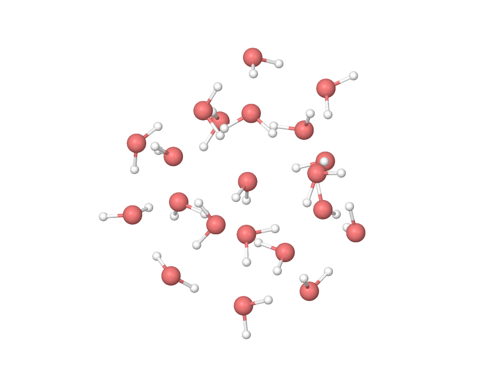</a>
  
   多巴胺 · ES 内置 · 金刚烷 · CPK 球棍 · 水笼 · 粉彩球棍 · 18-冠-6 · 空间填充

## 工作台预览

  <a href="docs/images/showcase/workbench-modeling-es-default.png">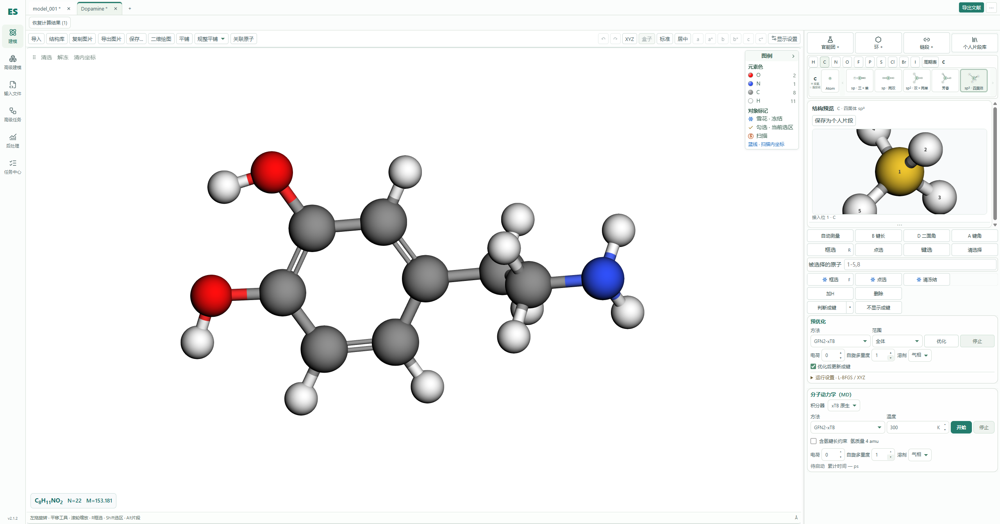</a>
  
  
  <a href="docs/images/showcase/workbench-wavefunction.png">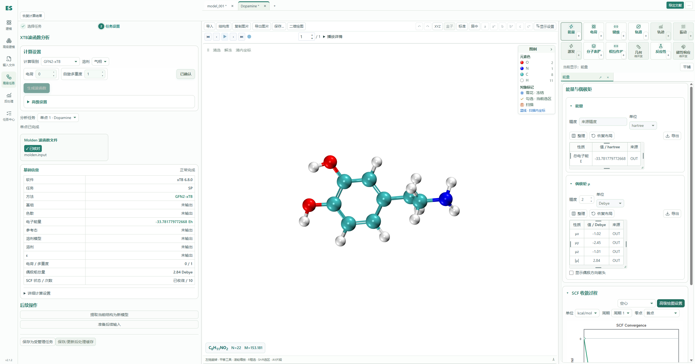</a>
   ES 默认建模 · 周期晶体 · 构象搜索 · 波函数后处理

  <a href="docs/images/showcase/workbench-infrared.png">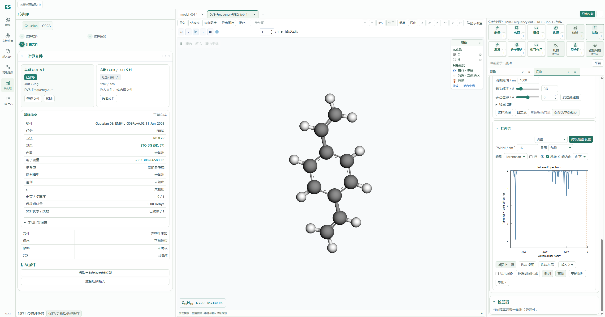</a>
  
  
  
   振动与红外分析 · IRC 反应路径 · IRC 切帧实录 · VMD 风格建模

- **建模与输入。** 编辑分子、晶体和片段，从二维结构生成三维初猜，准备 Gaussian 与 ORCA 输入。
- **构象与轨迹。** 组合采样、逐级优化和归簇，播放轨迹时查看逐帧连接、晶胞及冻结原子。
- **反应路径与后处理。** 运行适用的内坐标扫描、CI-NEB、FSM 或双端 GSM，分析 TS、振动、IRC 和波函数。

2.1.4 支持昼夜界面和独立三维画布底色，改进构象批量优化、标签管理及助手的过渡态与 IRC 工作流。

[查看 2.1.4 的完整更新](https://github.com/Ahey1/Ester-Studio/releases/tag/v2.1.4)

## 实算图例与结构外观

### ES 默认轨道与表面静电势

  
  <a href="docs/images/showcase/dopamine-lumo.png">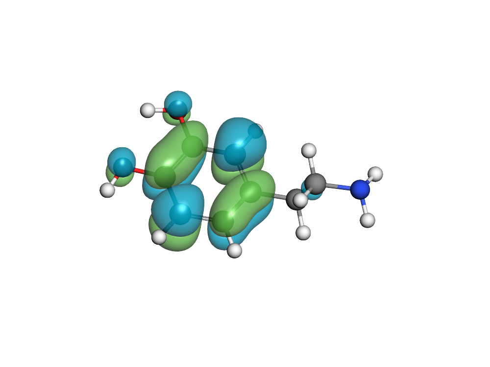</a>
  <a href="docs/images/showcase/dopamine-esp-arial.png">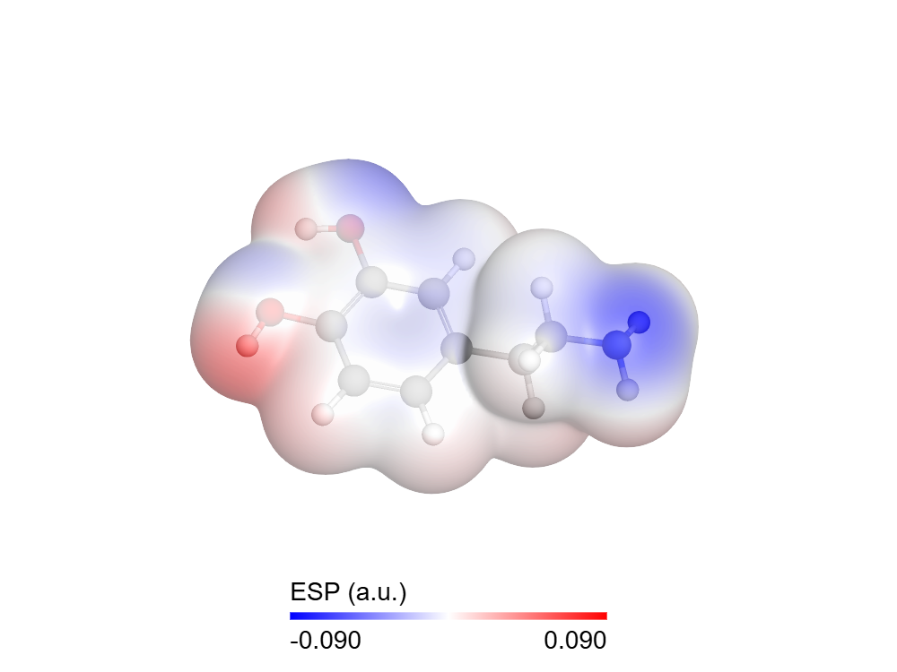</a>
  
   多巴胺 HOMO · 多巴胺 LUMO · 分子表面静电势（ESP）着色 · 多巴胺电子密度

### 相互作用与结构预设

  
  <a href="docs/images/showcase/benzene-stack-igmh-arial.png">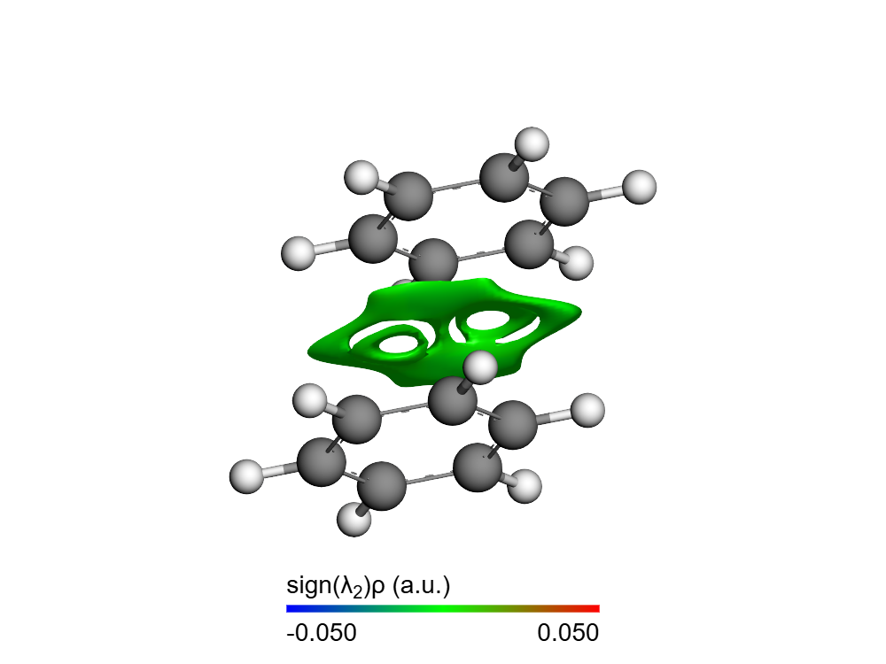</a>
  <a href="docs/images/showcase/water-cage-hirshfeld-arial.png">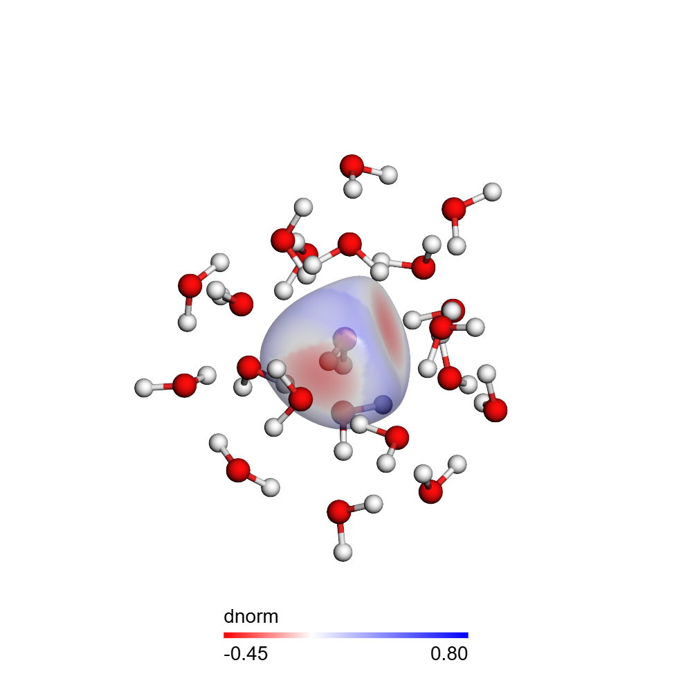</a>
  
   苯二聚体 IRI · 苯二聚体 IGMH · 水笼 Hirshfeld 表面 · 咖啡因 · 铜棕珠光

  
  
  
  
   VESTA 风格 HOMO · VESTA 风格电子密度 · Trp-cage · VMD 青碳 · 金刚石 · VMD 青碳

  
  <a href="docs/images/showcase/diamond-crystal.png">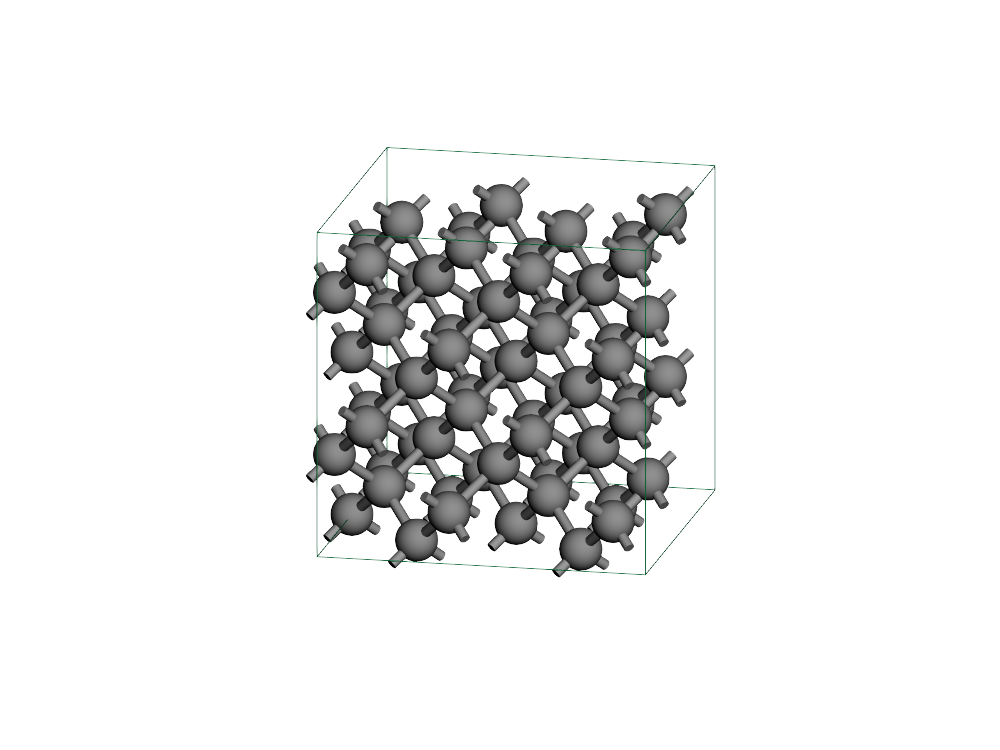</a>
  <a href="docs/images/showcase/barium-titanate-crystal.png">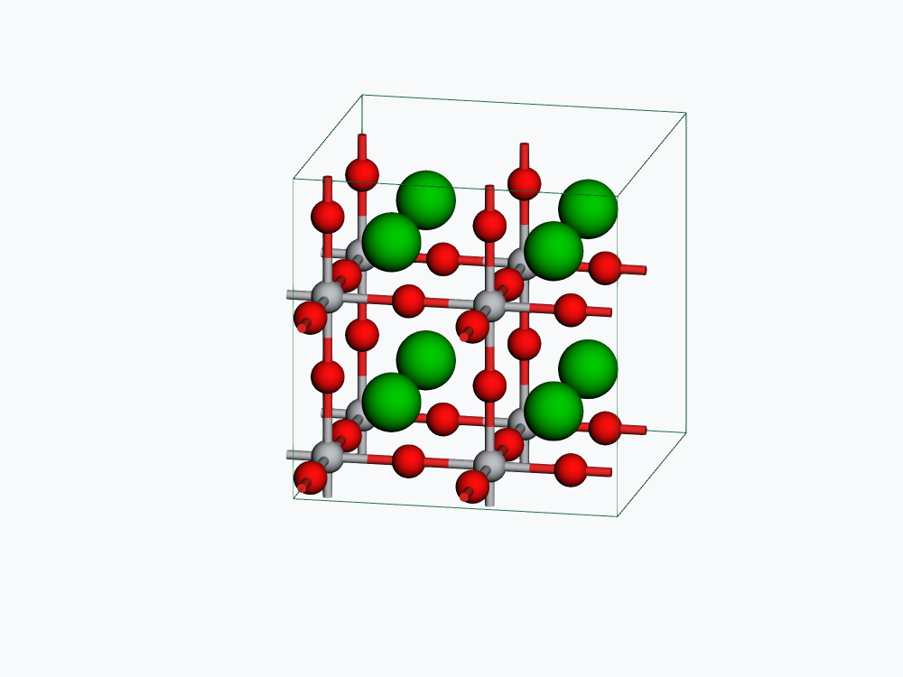</a>
  
   岩盐型 NaCl · 金刚石晶胞 · 立方 BaTiO₃ · Cu(111) 四层表面

  
  
  <a href="docs/images/showcase/barium-titanate-space.png">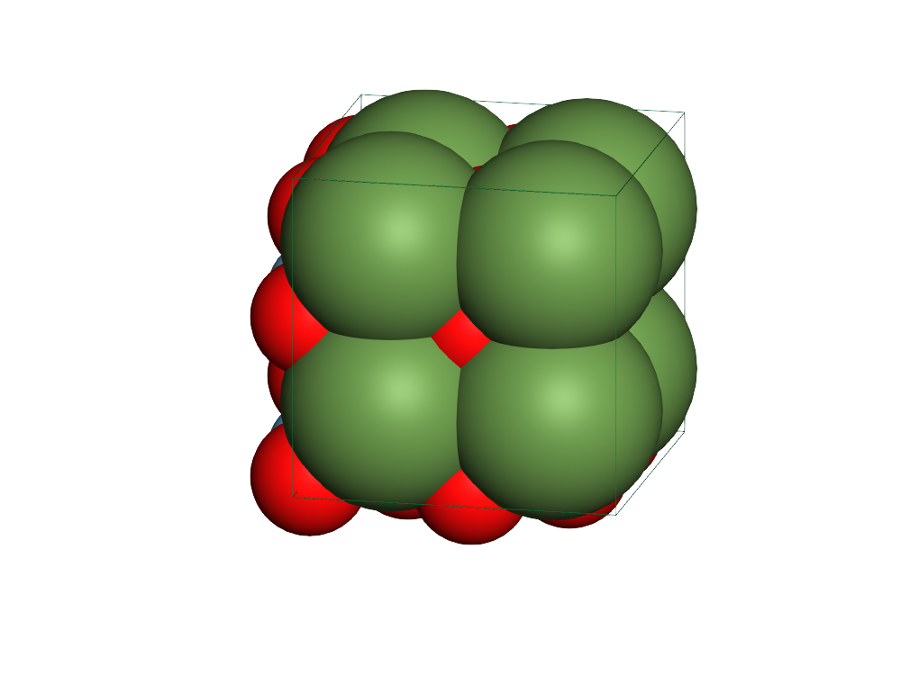</a>
  
   NaCl · 空间填充 · BaTiO₃ · 铜棕珠光 · BaTiO₃ · 空间填充 · Cu(111) · 空间填充

## 数据图

### 光谱图集

  <a href="docs/images/spectra/s03.png">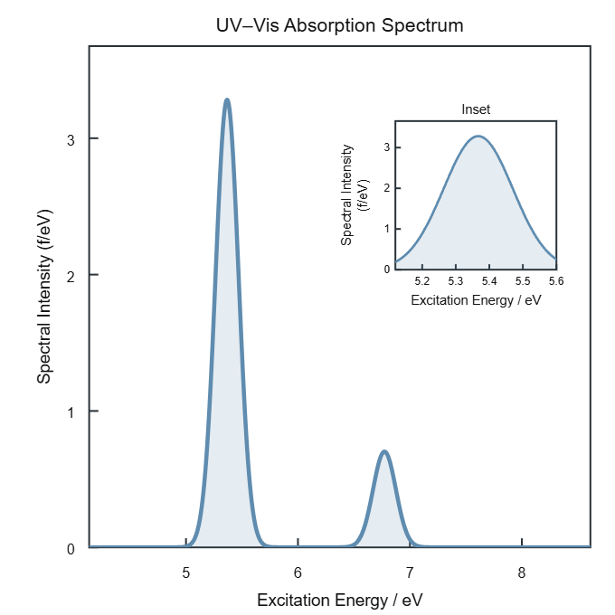</a>
  
  
  
   紫外吸收与主峰副图 · 红外与指纹区副图 · 拉曼 Stokes 与主峰副图 · 水的 O–H 伸缩区

### 能级与强度

  <a href="docs/images/showcase/dopamine-orbital-levels.png">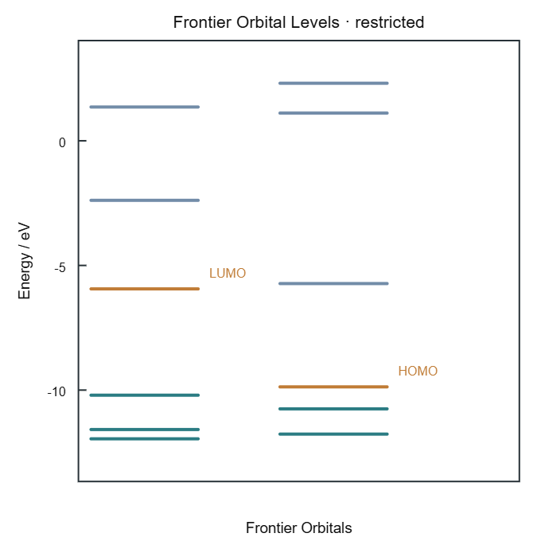</a>
  
  
  
   多巴胺分子轨道能级 · ORCA 振子强度 · 红外积分强度 · 拉曼活性

### 散点、指纹与优化曲线

  
  
  <a href="docs/images/showcase/water-cage-fingerprint.png">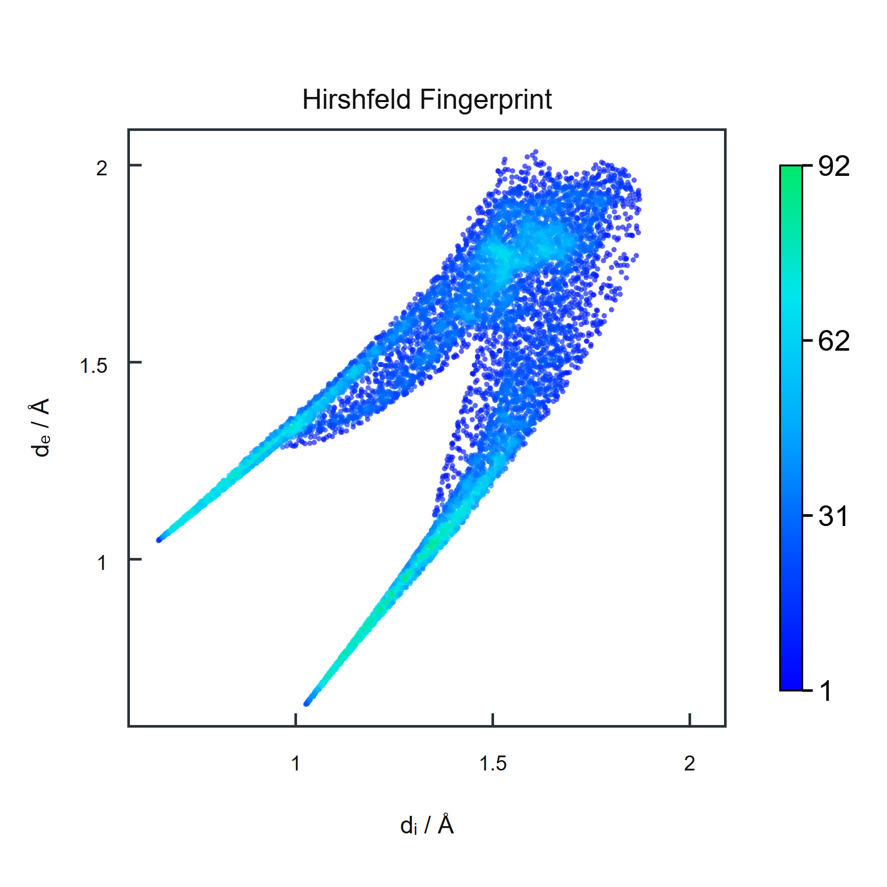</a>
  <a href="docs/images/showcase/dopamine-optimization-hollow.png">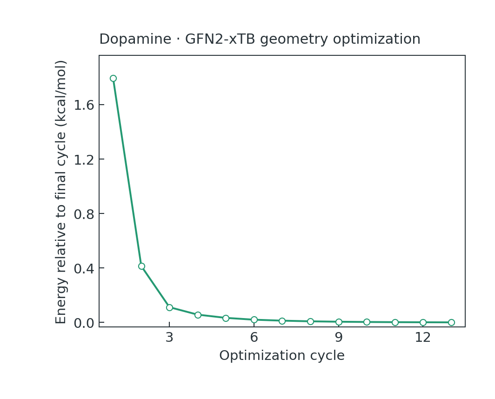</a>
   IRI 散点 · IGMH 散点 · 水笼指纹图 · 多巴胺优化收敛

## 下载与使用

完整解压 Windows x64 便携包，运行 **Ester-Studio.exe**。首次启动请阅读许可并确认计算资源。2.1.4 随包提供 GFN0/1/2-xTB 与 GFN-FF 运行环境。部分波函数分析按需配置 Multiwfn，运行 Gaussian 或 ORCA 作业时使用各自的外部程序。

### 项目兼容、外部程序和源码附件

- 2.1.4 可以载入 2.x 的旧 `.es`，保存采用当前格式。已有神经网络势计算结果可以查看和导出，保留方法、能量、轨迹和来源。新计算可使用本版提供的计算级别。
- g-xTB 从[官方发布页](https://github.com/grimme-lab/g-xtb/releases)获取，在 Settings 中选择和检测可执行文件。
- 本仓库提供软件介绍、展示资料和发行入口。完整产品源码发布在独立的 `Ester-Studio-v2.1.4-source-code.zip`。自动生成的 Source code 附件对应此介绍仓库。
- [历史版本](https://github.com/Ahey1/Ester-Studio/releases) · [教程与视频](https://space.bilibili.com/3493133310495553) · [问题与建议](https://github.com/Ahey1/Ester-Studio/issues)

## 引用与许可

请同时引用研究中实际使用的方法、程序和数据来源。可以通过软件右上角「导出文献」核对条目。2.1.4 的非商业用途免费，商业用途须事先取得作者书面许可。完整条款见 [LICENSE.txt](LICENSE.txt)，第三方组件适用各自的许可。

作者 **Zixuan Zhang** · 许可事务 **ddwz@sciyue.cn**

## 绘图方法与参考文献

- **电子结构与等值面。** 多巴胺用 GFN2-xTB 优化并计算波函数，使用 Multiwfn 生成轨道、静电势和总电子密度格点。能级图使用同一次波函数计算的轨道能量与占据数。轨道等值为 ±0.030 bohr⁻³ᐟ²，密度图和静电势图的表面取 ρ = 0.001 e/bohr³。[GFN2-xTB](https://doi.org/10.1021/acs.jctc.8b01176) · [Multiwfn](https://doi.org/10.1002/jcc.22885)
- **相互作用与分子表面。** 苯二聚体从 S66 的错位平行构型起步，使用 GFN2-xTB 优化，并绘制 IRI 与 IGMH。水笼以中央水分子的 Hirshfeld 权重 0.5 取面，按 dₙₒᵣₘ 着色，指纹图使用近邻核距离 dᵢ 和 dₑ。[S66](https://doi.org/10.1021/ct2002946) · [IRI](https://doi.org/10.1002/cmtd.202100007) · [IGMH](https://doi.org/10.1002/jcc.26812) · [Hirshfeld 表面](https://doi.org/10.1039/B818330A) · [指纹图](https://doi.org/10.1039/B203191B)
- **光谱。** 数据图根据 Gaussian 和 ORCA 的计算结果绘制。二乙烯基苯例使用 cclib 公共测试数据。紫外吸收用高斯展宽，半高全宽为 0.24 eV。红外和拉曼用洛伦兹展宽，半高全宽为 20 cm⁻¹。拉曼 Stokes 谱按 532 nm 和 298.15 K 计算并归一化。柱图展示原始振子强度、红外积分强度或拉曼活性。[Gaussian](https://gaussian.com/) · [ORCA](https://doi.org/10.1002/wcms.81) · [cclib](https://doi.org/10.1002/jcc.20823)
- **结构与外观。** 分子和晶体图由 Ester Studio 渲染，部分外观参考 VMD 和 VESTA。小分子起始构象和晶体示例使用 PubChem 与 COD 数据，Trp-cage 取自 PDB 1L2Y。[PubChem](https://pubchem.ncbi.nlm.nih.gov/) · [COD](https://www.crystallography.net/cod/) · [PDB 1L2Y](https://www.rcsb.org/structure/1L2Y) · [VMD](https://doi.org/10.1016/0263-7855(96)00018-5) · [VESTA 3](https://doi.org/10.1107/S0021889811038970)
