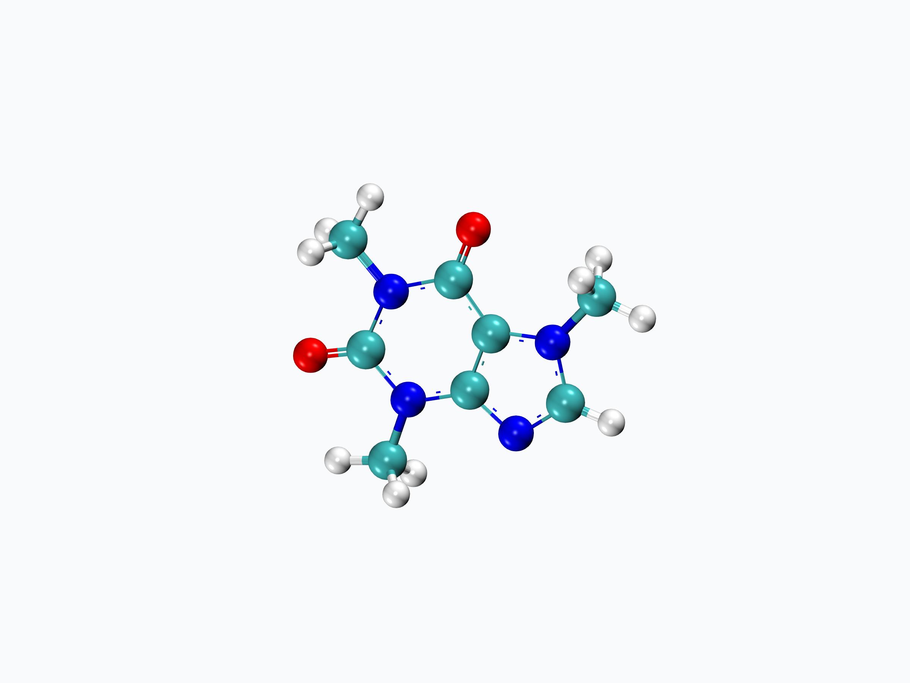
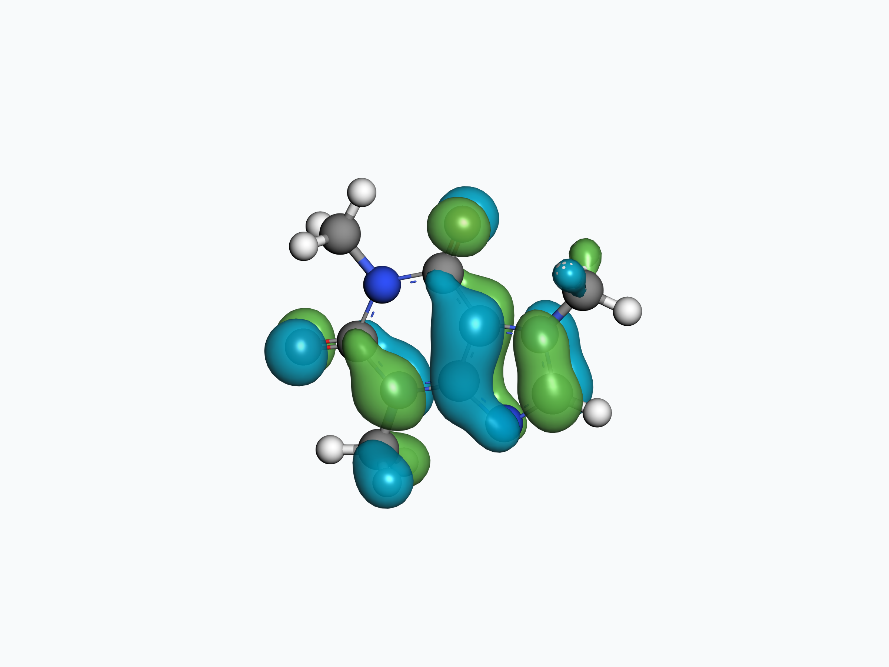
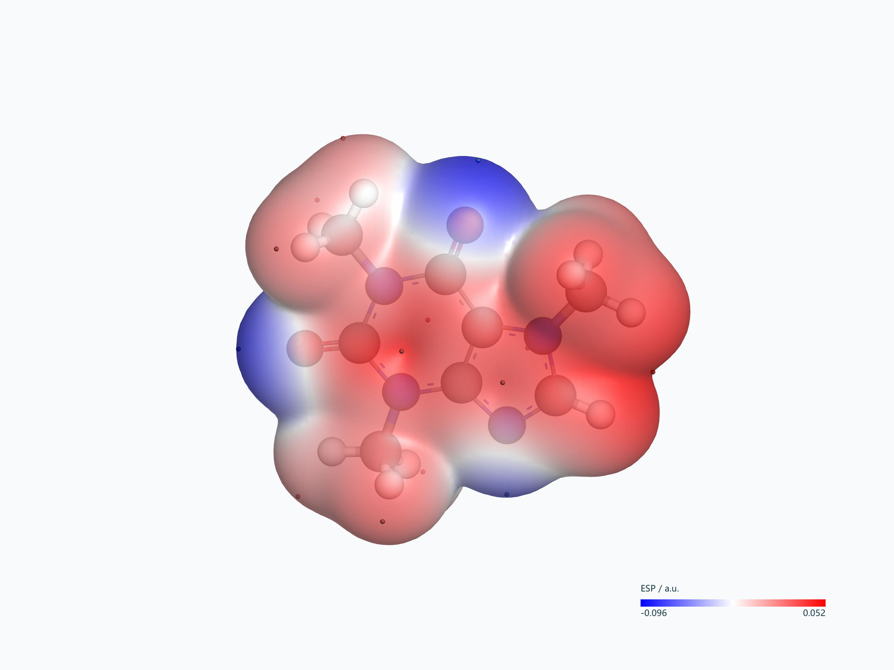

# Ester Studio

**一站式计算化学建模、输入准备与结果后处理工作台**

免费使用 · 源码公开 · 免安装 · 开箱即用

[下载 Windows 便携版](https://github.com/Ahey1/Ester-Studio/releases/download/v1.0.1/Ester-Studio-v1.0.1-Windows-x64.zip) · [下载完整源码](https://github.com/Ahey1/Ester-Studio/releases/download/v1.0.1/Ester-Studio-v1.0.1-source-code.zip) · [碘到为酯 · B站](https://space.bilibili.com/3493133310495553)

## 从结构到结果

- **建模**：分子与晶体、片段与结构库、周期结构与预优化。
- **输入准备**：Gaussian / ORCA 方法、基组、电荷与自旋、溶剂、约束和资源设置。
- **结果与后处理**：结构与能量、轨道与振动、激发态、NTO、ESP、IRI / IGMH。
- **科研出图**：四种分子模型预设、自定义光照与材质、完整图片与透明背景导出。

## 软件实际出图

以下图片均由软件实际导出，完整保留画面；模型为公开咖啡因结构。

<table><tr><td align="center"> 青碳高光模型</td><td align="center"> HOMO 轨道</td></tr></table>

ESP 着色分子表面 · 保留色尺与单位

轨道和ESP示例来自咖啡因GFN2-xTB气相单点，后处理调用用户配置的Multiwfn完成，不标作DFT或NTO结果。

## 下载与使用

当前首发版本为 **1.0.1**，后续统一采用 **1.0.x** 版本形式。通过[版本页](https://github.com/Ahey1/Ester-Studio/releases/tag/v1.0.1)下载两个附件，SHA-256见版本说明。

本仓库仅维护介绍页、展示图片和发行下载，不存放产品源码树。GitHub自动生成的Source code (zip/tar.gz)仅含介绍站；完整产品源码请下载 **Ester-Studio-v1.0.1-source-code.zip**。

完整解压后运行 **Ester-Studio.exe**。首次启动先阅读LICENSE，再核对计算资源，默认4核、8 GiB。新项目使用 **.es**，兼容早期.sy项目。常规使用无需另装Python、Node.js或开发工具；部分波函数分析需要自行配置Multiwfn。Gaussian/ORCA输入生成与结果读取不代表内置这两款计算程序。

当前以Windows 11为验收环境，Windows 10后续验证。

## 许可与交流

免费使用，遵循[自定义许可](LICENSE.txt)；销售软件副本需作者书面授权。第三方组件遵循各自许可，发行附件包含相应材料。

[碘到为酯 · B站主页](https://space.bilibili.com/3493133310495553) · [提交问题或建议](https://github.com/Ahey1/Ester-Studio/issues)

作者：**Zixuan Zhang** · 许可事务：**ddwz@sciyue.cn**

欢迎提供版本、系统、复现步骤与截图。目前官方主线由作者维护，不直接接收外部代码合入。
