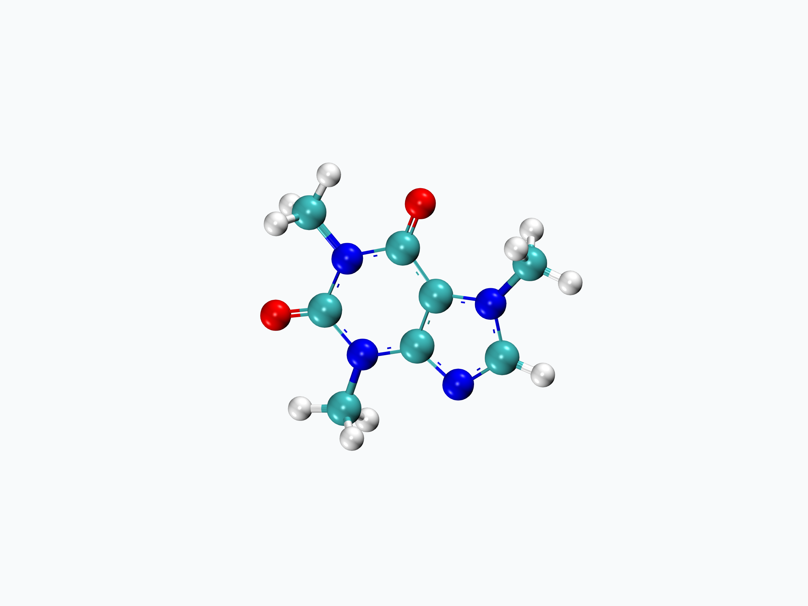
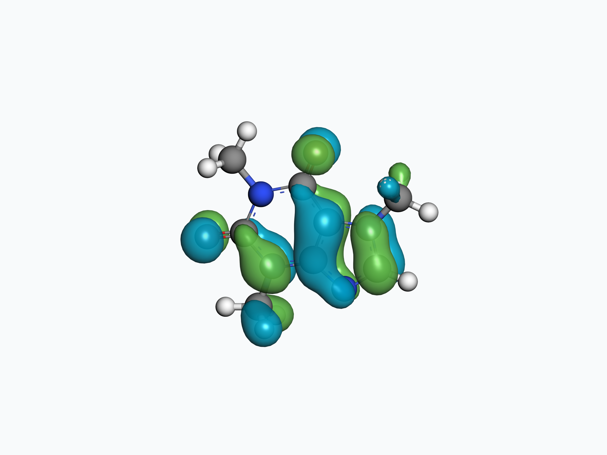
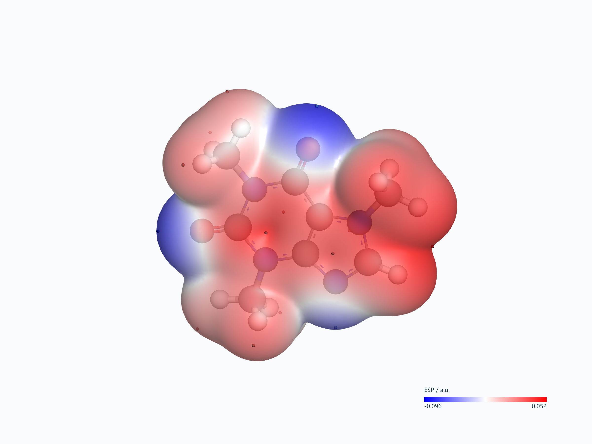

# Ester Studio

**一站式计算化学建模、输入准备与结果后处理工作台**

免费使用 · 源码公开 · 免安装 · 开箱即用

## 如何引用

使用 Ester Studio（ES）开展研究并发表论文时，请说明软件用于哪一步，并在参考文献中注明实际使用的版本。期刊条件允许时，请尽量在论文正文中标注引用。

**Ester Studio 2.1.2 推荐引用**

> Zhang, Z. *Ester Studio*, version 2.1.2 [computer software]. GitHub, 2026. https://github.com/Ahey1/Ester-Studio/releases/tag/v2.1.2

请同时引用实际使用的计算方法、程序和数据库。软件右上角的「导出文献」可查看和导出实际使用的方法、科研软件与数据来源。科研引用义务和补正规则见 [LICENSE.txt](LICENSE.txt)。

## 下载与使用

当前版本为 **2.1.2**，Windows x64 便携版。完整解压后运行 **Ester-Studio.exe**。

[下载 Windows 便携版](https://github.com/Ahey1/Ester-Studio/releases/download/v2.1.2/Ester-Studio-v2.1.2-Windows-x64.zip) · [下载完整源码](https://github.com/Ahey1/Ester-Studio/releases/download/v2.1.2/Ester-Studio-v2.1.2-source-code.zip) · [更新说明和 SHA-256](https://github.com/Ahey1/Ester-Studio/releases/tag/v2.1.2)

常规使用无需另装 Python、Node.js、CUDA 或开发工具。本版集成 GFN0/1/2-xTB 和 GFN-FF 所需计算环境，神经网络势功能留待后续版本。部分波函数分析需按需配置 Multiwfn。Gaussian／ORCA 输入生成与结果读取使用现有工作台，需要提交这两款程序的计算时自行配置相应环境。

首次启动先阅读 LICENSE，再核对计算资源，默认 4 核、8 GiB。项目使用 **.es**。2.x 新版支持载入该主版本的旧工程，保存使用当前格式。已有 NET 结果保留其原方法名称、能量、轨迹和来源，可继续查看与导出。

需要运行 **g-xTB** 时，从[官方发布页](https://github.com/grimme-lab/g-xtb/releases)下载并完整解压，在 Settings 中选择可执行文件并检测，无需修改系统 PATH。

本仓库维护介绍页、展示图片和发行下载。完整产品源码由独立的 **Ester-Studio-v2.1.2-source-code.zip** 提供，GitHub 自动生成的 Source code 附件包含本仓库的介绍内容。

在 Windows 11 x64（Build 26100）实机上，从正式 ZIP 解压，使用独立用户数据、临时目录及仅含 Windows 的 PATH 运行。内置 GFN 科学短算调用随包的 libxtb、tblite 和 Python。

[查看 2.1.1 历史版本](https://github.com/Ahey1/Ester-Studio/releases/tag/v2.1.1)

## 从结构到结果

- **建模与二维生成**支持分子、晶体、片段与结构库、ChemDraw 文件导入、离线图片识别与校改、实时三维预览及多片段立体结构生成。
- **构象与轨迹**支持混合采样、逐级抽帧优化、归簇与布居、逐帧成键、播放和叠合。大轨迹采用分页准备，已完成采样和优化结果可恢复。
- **势能面与反应路径**支持组合内坐标扫描、CI-NEB、FSM、双端 GSM、过渡态与频率、IRC 与 Downhill。独立 CALC 工作台可继续优化、TS 和 Freq。
- **内置 GFN 计算**支持 GFN0/1/2-xTB、GFN-FF、多步常驻求值、固定晶胞优化和适用的周期任务，保留方法、冻结、约束及来源。
- **输入准备与任务**支持 Gaussian／ORCA 输入，以及 Windows、WSL2、SSH、SSH＋Slurm 环境下的提交、监控和结果归档。
- **后处理与科研出图**支持结构与能量、轨道与振动、激发态、NTO、ESP、IRI／IGMH，以及可保存的分子外观、图表和色尺预设。
- **PES 路径能量图**在 FSM 完成、CI-NEB 第 0 轮全珠能量到齐和末轮收敛时自动显示。已画轮次与设置可恢复，曲线选点关联对应结构。

## 软件实际出图

以下图片均由软件实际导出，完整保留画面，模型为公开咖啡因结构。

<table><tr><td align="center"> 青碳高光模型</td><td align="center"> HOMO 轨道</td></tr></table>

ESP 着色分子表面 · 保留色尺与单位

轨道和 ESP 示例来自咖啡因 GFN2-xTB 气相单点，后处理调用用户配置的 Multiwfn 完成。

## 许可与交流

免费使用，遵循[自定义许可](LICENSE.txt)。销售软件副本需作者书面授权。第三方组件遵循各自许可，发行附件包含相应材料。

[碘到为酯 · B站主页](https://space.bilibili.com/3493133310495553) · [提交问题或建议](https://github.com/Ahey1/Ester-Studio/issues)

作者 **Zixuan Zhang** · 许可事务 **ddwz@sciyue.cn**

欢迎提供版本、系统、复现步骤与截图。目前官方主线由作者维护。
