# Ester Studio 实算图集

[返回仓库首页](../README.md)

首页首图使用 Ester Studio 内置默认预设。本图册展示 ES 的 VMD 青碳高光与其他可选绘图预设。三维图保留计算或导入的几何坐标、等值与色尺。下方工作台截图来自 Windows 便携版 2.1.2。

## 多巴胺

以 [PubChem CID 681](https://pubchem.ncbi.nlm.nih.gov/compound/681) 的 3D 构型为起点。在气相中取中性单重态，用 GFN2-xTB 6.8.0 优化，13 步收敛。对收敛几何重新单点并输出 Molden 波函数。用 Multiwfn 2026.10.18 计算轨道格点、电子密度和 ESP。

| 图 | 绘图参数 |
| --- | --- |
| [球棍模型](images/showcase/dopamine-structure.png) | 优化后的结构 |
| [HOMO](images/showcase/dopamine-homo-gloss.png) · [LUMO](images/showcase/dopamine-lumo-gloss.png) | 第 30 和 31 轨道，等值 ±0.035 bohr⁻³ᐟ² |
| [单色电子密度](images/showcase/dopamine-density.png) · [ESP 着色表面](images/showcase/dopamine-esp.png) | ρ = 0.001 e/bohr³；ESP 原子单位 |

## 面对面苯二聚体

初始结构为 [S66 第 24 例苯二聚体](https://doi.org/10.1021/ct2002946)。GFN2-xTB 气相优化后，两环近乎平行，层间距 3.3045 Å，横向错位 1.2159 Å。两个苯分子分别对应原子 1–12 与 13–24。IRI 和 IGMH 使用相同的优化后波函数，格距 0.20 Bohr。等值面均按 sign(λ₂)ρ 着色。

| 图 | 绘图参数 |
| --- | --- |
| [IRI 等值面](images/showcase/benzene-stack-iri.png) · [IRI 散点图](images/showcase/benzene-stack-iri-scatter.png) | IRI = 1.0 |
| [IGMH 等值面](images/showcase/benzene-stack-igmh.png) · [IGMH 散点图](images/showcase/benzene-stack-igmh-scatter.png) | 片段间 δg = 0.0015 a.u. |

  <a href="images/showcase/benzene-stack-iri-scatter.png">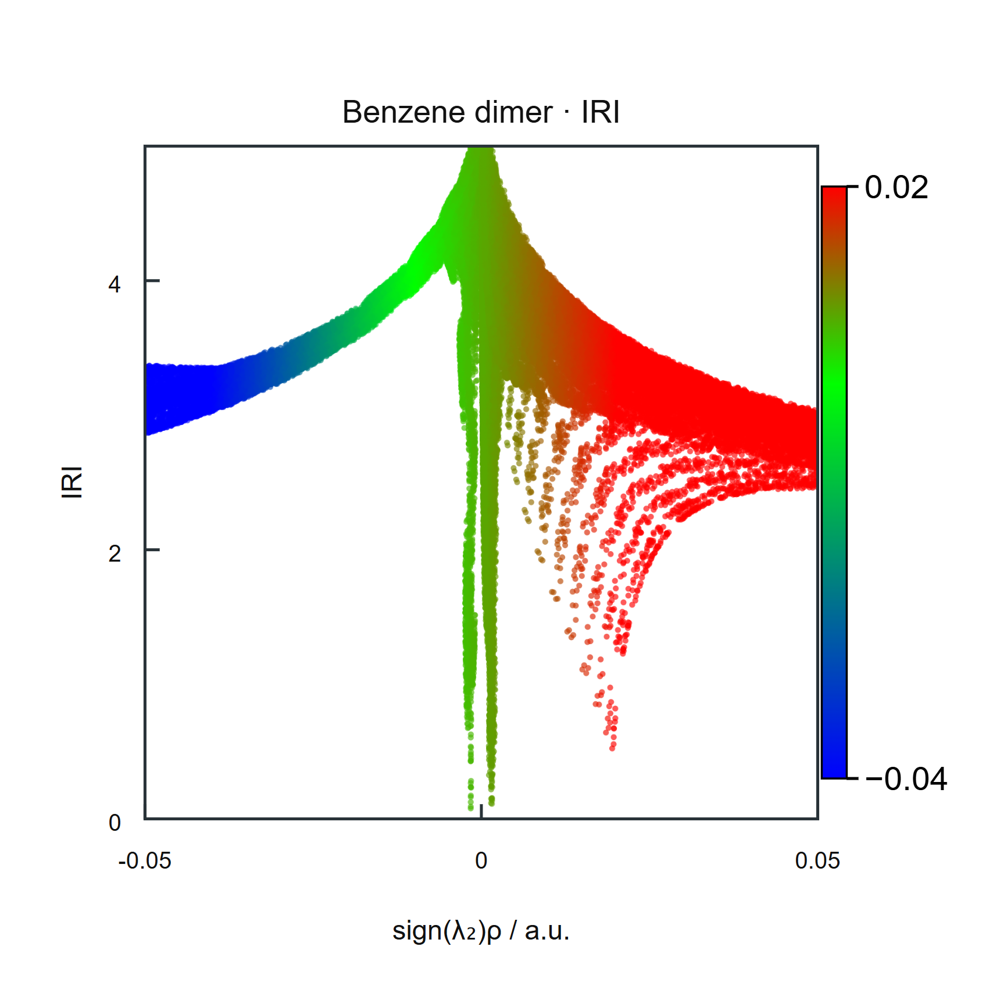</a>
  <a href="images/showcase/benzene-stack-igmh-scatter.png">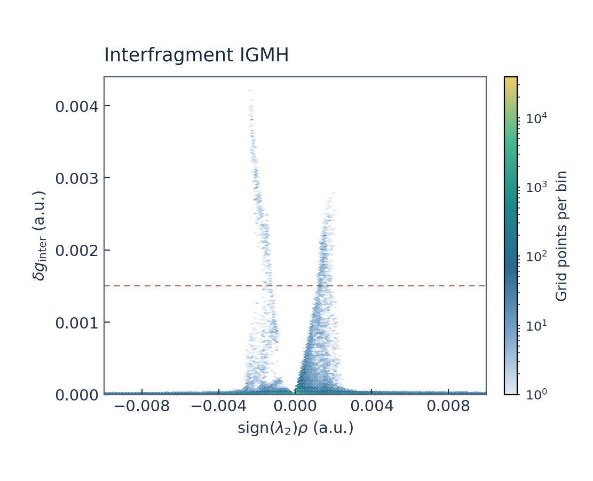</a>

散点图对同一计算网格上的两种场量逐点配对。色尺给出每格点数，虚线标记等值面采用的等值。坐标范围聚焦相互作用附近。

## 水笼中央水

从独立构建的十二面体外层水笼起步，放入一个中央水。用 GFN2-xTB 对中性单重态 (H₂O)₂₁ 在气相中优化。优化结构中，中央氧到最近四个外层氧的距离为 2.64–2.71 Å。用 Multiwfn 在完整团簇上计算中央水的 Hirshfeld 权重 0.5 表面，格距 0.15 Bohr。

[Hirshfeld 表面原图](images/showcase/water-cage-hirshfeld.png) · [指纹图原图](images/showcase/water-cage-fingerprint.png)

总接触面积为 39.055 Ų。二维指纹使用同次计算导出的 8,927 对 dᵢ 与 dₑ，颜色表示 0.02 Å 邻域内的点数。表面积和指纹点密度是两个不同的量。

## 结构预设

相同优化坐标和取景下的 [青碳高光](images/showcase/dopamine-structure.png)、[CPK 球棍](images/showcase/dopamine-preset-cpk.png)、[粉彩球棍](images/showcase/dopamine-preset-pastel.png)、[元素线稿](images/showcase/dopamine-preset-line-art.png)、[铜棕珠光](images/showcase/dopamine-preset-vesta-pearl.png) 和 [空间填充](images/showcase/dopamine-preset-space-filling.png)。

## 轨道预设

同一个多巴胺 HOMO，等值 ±0.035 bohr⁻³ᐟ²。两种颜色分别标记波函数的正相位和负相位。

  <a href="images/showcase/dopamine-homo-gloss.png">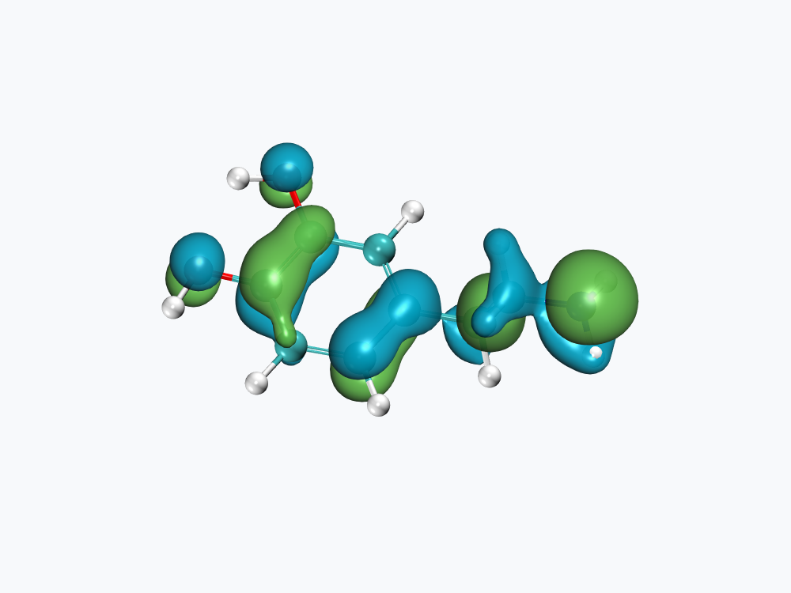</a>
  <a href="images/showcase/dopamine-homo-vesta.png">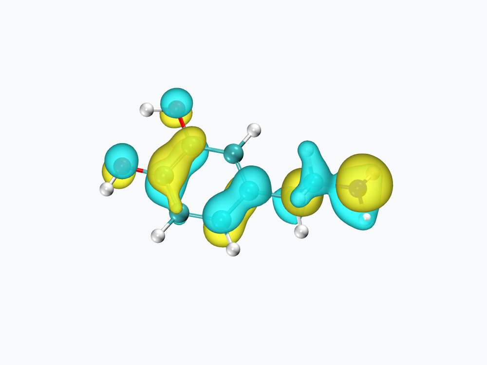</a>
   轨道高光 · VESTA 青蓝与黄

## 表面与相互作用预设

同一组格点和等值下比较配色与光照。下列对照的每行使用相同的科学数据。

| 数值场 | 标准风格 | 图库风格 |
| --- | --- | --- |
| 多巴胺 ESP | [静电势色带](images/showcase/dopamine-esp-standard.png) | [ESP 柔光](images/showcase/dopamine-esp.png) |
| 苯二聚体 IRI | [IRI 色带](images/showcase/benzene-iri-standard.png) | [IRI 柔光](images/showcase/benzene-stack-iri.png) |
| 苯二聚体 IGMH | [IGMH 色带](images/showcase/benzene-igmh-standard.png) | [IGMH 高光](images/showcase/benzene-stack-igmh.png) |
| 多巴胺电子密度 | [单色密度](images/showcase/dopamine-density.png) |  |
| 水笼中央水 | [Hirshfeld 表面](images/showcase/water-cage-hirshfeld.png) |  |

 <a href="images/showcase/dopamine-esp-standard.png">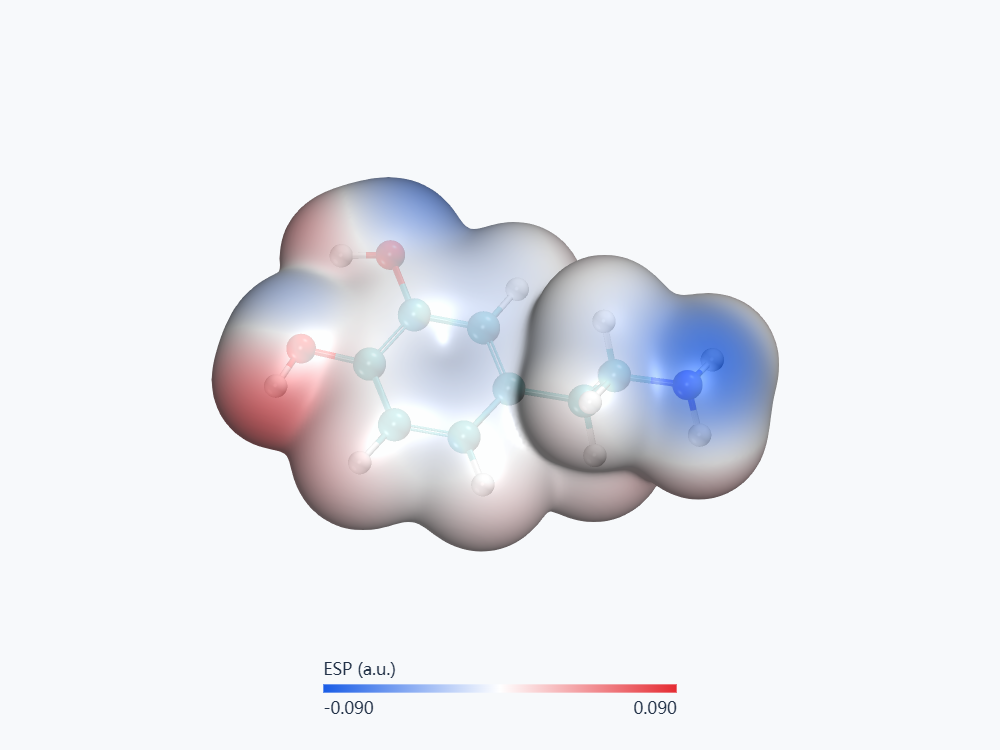</a>
 <a href="images/showcase/dopamine-esp.png">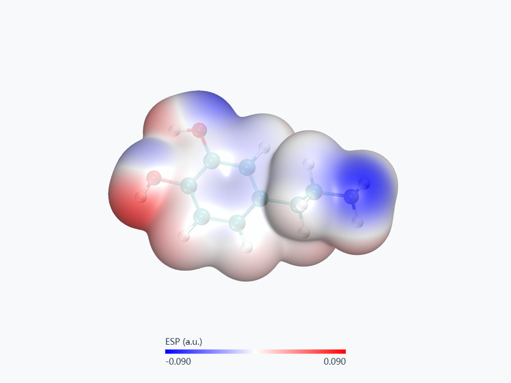</a>
  标准静电势色带 · ESP 柔光

 
 <a href="images/showcase/benzene-stack-iri.png">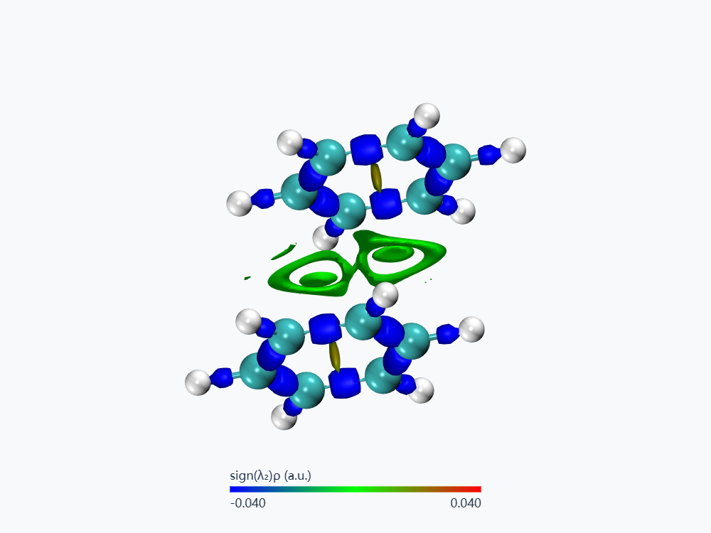</a>
  标准 IRI 色带 · IRI 柔光

 <a href="images/showcase/benzene-igmh-standard.png">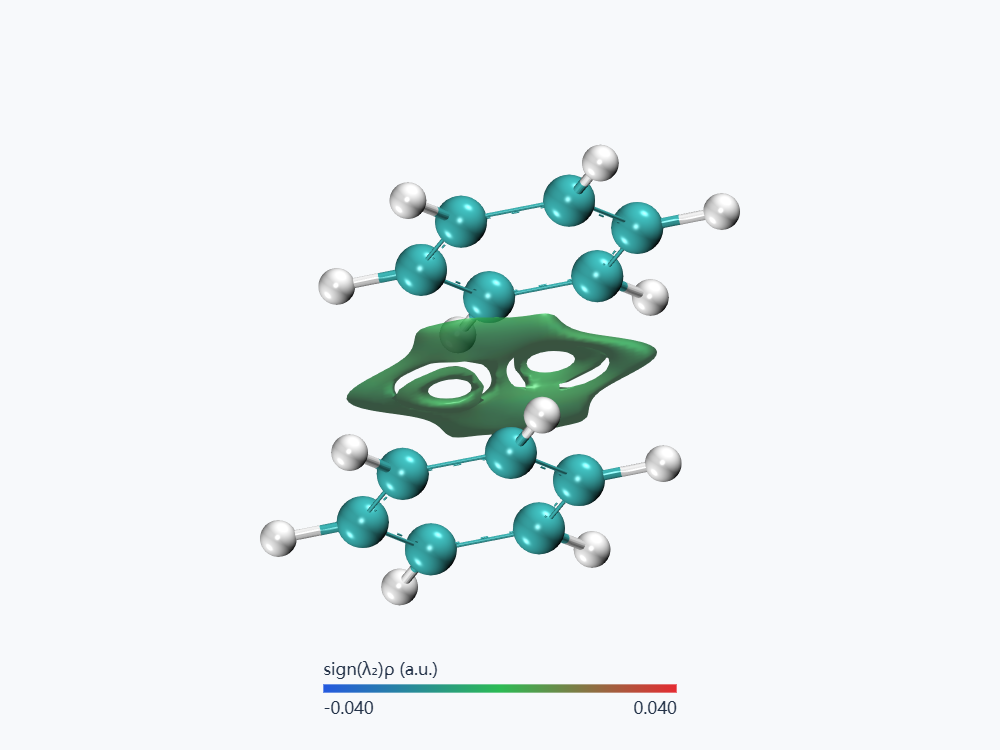</a>
 <a href="images/showcase/benzene-stack-igmh.png">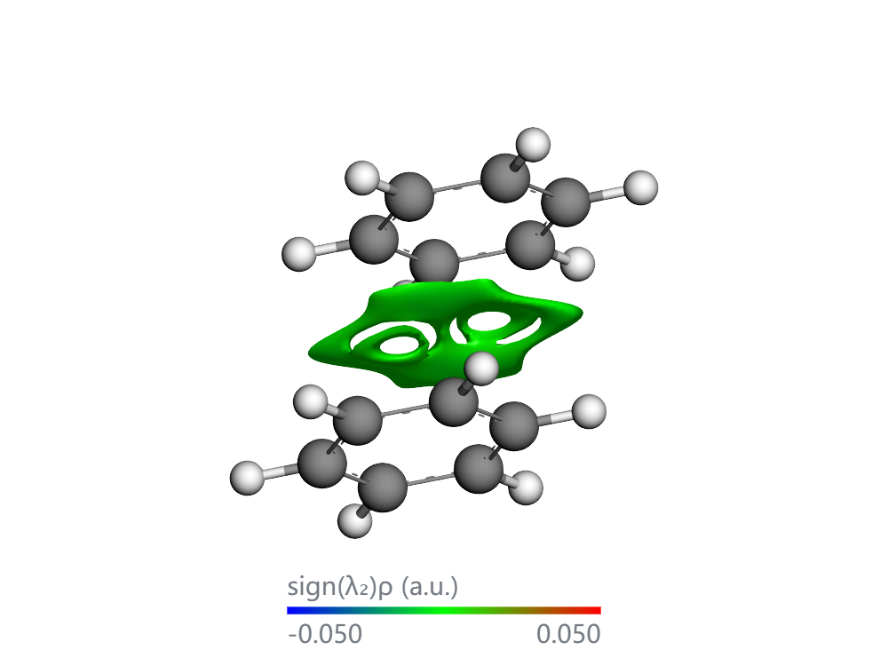</a>
  标准 IGMH 色带 · IGMH 高光

## 点线图预设

按 ES 的空心、实心点线样式绘制同一组多巴胺优化数据。13 个点均来自 xTB 优化输出，能量以最后一步为零点。

  <a href="images/showcase/dopamine-optimization-hollow.png">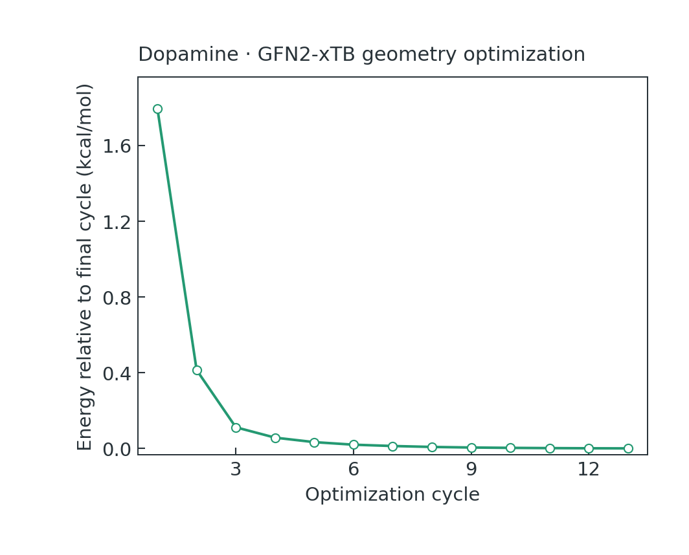</a>
  <a href="images/showcase/dopamine-optimization-solid.png">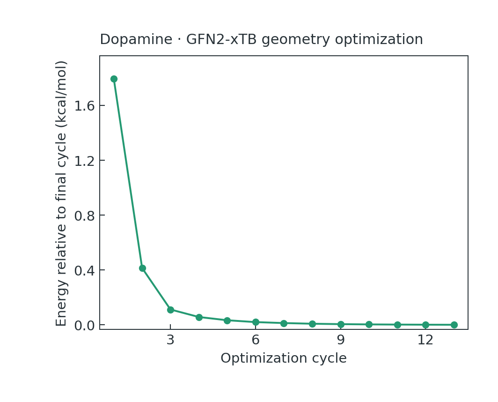</a>
   空心点线 · 实心点线

\n## 工作台实窗

- [多巴胺 GFN2-xTB 波函数分析工作台](images/showcase/workbench-wavefunction.png)
- [分子建模 · 内置默认](images/showcase/workbench-modeling-es-default.png) · [分子建模 · VMD 青碳](images/showcase/workbench-modeling.png) · [周期结构建模](images/showcase/workbench-periodic.png)
- [构象搜索](images/showcase/workbench-conformer.png) · [IRC 路径](images/showcase/workbench-irc.png) · [能量曲线选点实录](images/showcase/workbench-irc.gif)

## 方法来源

[GFN2-xTB](https://doi.org/10.1021/acs.jctc.8b01176) · [Multiwfn](https://doi.org/10.1002/jcc.22885) · [IRI](https://doi.org/10.1002/cmtd.202100007) · [IGMH](https://doi.org/10.1002/jcc.26812) · [Hirshfeld 表面与指纹](https://doi.org/10.1039/B818330A)
